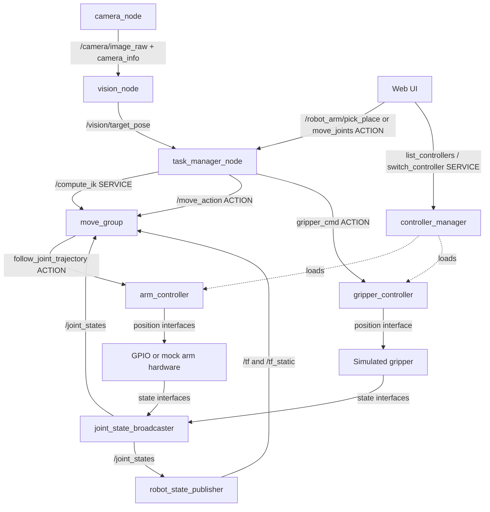

# Analysis of the supplied logic diagram

[Documentation home](../README.md) · [Setup and operation](setup-and-operation.md) · [Configuration reference](configuration.md)

The diagram is a ROS 2 control/planning architecture. Its arrows are not all topics: it explicitly distinguishes **topics**, **services**, **actions**, and internal ros2_control command/state interfaces. Long-running motion must be cancellable and report completion through actions.

The user confirmed two current A4988 motors: vertical Z and fixed-length arm rotation around Z; no homing switches; no physical gripper. The photograph establishes the general arm shape but does not supply geometry, motor resolution, gearing, lead, travel, camera calibration, or GPIO wiring beyond the separate Python example.

## What the existing motor test does

`web_test_motor.py` instantiates `RpiMotorLib.A4988Nema` with:

| Signal | BCM GPIO | Behaviour |
|---|---:|---|
| DIR | 20 | `True` above slider 10, `False` below 10 |
| STEP | 21 | 600 pulses per submitted request |
| MS1 | 17 | LOW in `Full` mode |
| MS2 | 27 | LOW in `Full` mode |
| MS3 | 22 | LOW in `Full` mode |

`step_delay = max(0.001, 0.006 - abs(slider - 10) * 0.0005)`. In the upstream library, this delay occurs in both the HIGH and LOW phases, so approximate pulse rate is `1 / (2 * step_delay)`, excluding scheduling overhead. For valid slider values, that is roughly 91–500 pulses/s. Each batch takes approximately 1.2–6.6 seconds plus its initial 0.05-second delay. The slider range is not validated on the HTTP endpoint.

The slider's stop branch merely returns a page. It neither invokes `motor_stop()` nor disables the driver. The single-threaded Flask server cannot receive another request during a blocking `motor_go()` call. There is no calibrated position, homing, acceleration profile, encoder feedback, software travel boundary, concurrent axis control, or ROS interface.

The new driver preserves the full-step STEP/DIR signalling and default Z pins. It uses libgpiod on the Pi's GPIO character device instead of depending on the original library's GPIO backend. The control loop hands targets to a separate pulse worker. Position estimates advance only when pulses are emitted, rather than immediately jumping to the requested position. Direction remains configurable because clockwise/counterclockwise depends on wiring and viewing direction.

Library reference: [RpiMotorLib A4988 implementation](https://github.com/gavinlyonsrepo/RpiMotorLib/blob/master/RpiMotorLib/RpiMotorLib.py).

## Exact communication map

All endpoints are absolute names in the root ROS namespace.

| Name from diagram | Kind and ROS type | Provider / publisher | Client / subscriber |
|---|---|---|---|
| `/camera/image_raw` | Topic · `sensor_msgs/msg/Image` | `camera_node` | `vision_node` |
| `/vision/target_pose` | Topic · `geometry_msgs/msg/PoseStamped` | `vision_node` | `task_manager_node` |
| `/robot_arm/pick_place` | Action · `roboarm_interfaces/action/PickPlace` | `task_manager_node` | Web UI |
| `/move_action` | Action · `moveit_msgs/action/MoveGroup` | `move_group` | `task_manager_node` |
| `/compute_ik` | Service · `moveit_msgs/srv/GetPositionIK` | `move_group` | `task_manager_node` |
| `/arm_controller/follow_joint_trajectory` | Action · `control_msgs/action/FollowJointTrajectory` | `arm_controller` | MoveIt controller manager |
| `/gripper_controller/gripper_cmd` | Action · `control_msgs/action/GripperCommand` | `gripper_controller` | `task_manager_node`; also registered with MoveIt |
| `/controller_manager/list_controllers` | Service · `controller_manager_msgs/srv/ListControllers` | `controller_manager` | Web UI |
| `/controller_manager/switch_controller` | Service · `controller_manager_msgs/srv/SwitchController` | `controller_manager` | Web UI |
| `/joint_states` | Topic · `sensor_msgs/msg/JointState` | `joint_state_broadcaster` | `move_group`, `robot_state_publisher`, task manager, Web UI |
| `/tf` | Topic · `tf2_msgs/msg/TFMessage` | `robot_state_publisher` | MoveIt and TF clients |
| `/tf_static` | Topic · `tf2_msgs/msg/TFMessage` | `robot_state_publisher`; external calibrated camera transform publisher | MoveIt and TF clients |

Camera images and calibration use sensor-data QoS (best effort). Vision targets use reliable depth 10. TF and controller services/actions use their standard ROS implementations and QoS. Action transport internally uses goal/result/cancel services and feedback/status topics; a plain topic cannot replace an action endpoint.

Additional endpoints needed for the implementation:

| Endpoint | Type | Purpose |
|---|---|---|
| `/camera/camera_info` | `sensor_msgs/msg/CameraInfo` topic | Camera intrinsics/distortion for metric marker pose |
| `/robot_description` | `std_msgs/msg/String` topic | Transient-local robot description from `robot_state_publisher` to controller manager |
| `/robot_arm/move_joints` | `roboarm_interfaces/action/MoveJoints` action | Absolute two-axis UI motion, serialized with pick/place |
| `/robot_arm/status` | `std_msgs/msg/String` topic carrying JSON | Task stage, busy/fault state, hardware mode and simulated-gripper status |
| `/vision/qr` | `std_msgs/msg/String` topic carrying JSON | Each new QR read: payload, quality, corners, whether it is a target |
| `/vision/part` | `std_msgs/msg/String` topic carrying JSON | Each part page recorded to `parts.csv` |
| `/vision/debug_image` | `sensor_msgs/msg/Image` topic | Scanned frame with QR outline and readout; published only while subscribed |

QR perception details, the mapping from the old program and Yocto packaging: [perception-qr.md](perception-qr.md).

## Nodes and packages

| Diagram component | Implementation | Responsibility |
|---|---|---|
| Web UI / Teleoperation | `roboarm_nodes/web.py` + `web.html` | Nonblocking action requests, cancel, settings, controller services |
| `task_manager_node` | `roboarm_nodes/task_manager.py` | Goal validation, one-motion-at-a-time ownership, IK requests, motion/gripper sequencing, cancellation propagation |
| `camera_node` | `roboarm_nodes/camera.py` | Explicit demo images, or libcamera (CSI IMX219) / picamera2 / USB / image-file frames and calibration |
| `vision_node` | `roboarm_nodes/vision.py` | Explicit demo target, or zbar QR reading: allowed code centre via solvePnP transformed into robot coordinates, part pages recorded to CSV |
| `stream_node` (optional) | `roboarm_nodes/stream.py` | `/vision/debug_image` as H.264 MPEG-TS over TCP, the former upd-rasp-stream-tcp viewer |
| `move_group` | Standard MoveIt 2 executable + `config/moveit.yaml` | Planning, planning scene, IK service, trajectory execution |
| IK solver | `roboarm_kinematics` C++ plugin | Analytic IK for Z + rotation; seeded equivalent-angle selection, joint bounds, orientation, collision callbacks |
| `controller_manager` | Standard `controller_manager/ros2_control_node` | Loads hardware and controller plugins; owns read/update/write loop |
| `arm_controller` | Standard `joint_trajectory_controller/JointTrajectoryController` | Executes timed Z/rotation trajectories and reports tracking status |
| `gripper_controller` | Standard `position_controllers/GripperActionController` | Keeps the diagram's `GripperCommand` action; simulated hardware only |
| `joint_state_broadcaster` | Standard controller plugin | Publishes exported hardware position/velocity state interfaces |
| `robot_state_publisher` | Standard executable | Computes link transforms from URDF and joint states |
| ros2_control hardware interface | `roboarm_hardware` C++ plugin, or `mock_components/GenericSystem` | Exposes joint interfaces, emits STEP/DIR, estimates position, checks bounds/watchdog |
| MCU + motor drivers | Current implementation uses Pi GPIO + A4988 directly | No MCU was specified. A dedicated MCU can later replace the pulse backend |

The standard ROS components are configured, not reimplemented as lookalike Python nodes. Hardware and controller plugins run inside the controller manager; they are not independent topic-relay nodes. The diagram's "joint commands" and "joint state interfaces" arrows are ros2_control interfaces, not invented `/motor_command` topics. No encoder stream is fabricated.

The Jazzy legacy gripper controller preserves `/gripper_controller/gripper_cmd` with `control_msgs/action/GripperCommand`. Its upstream replacement has a different interface; a future migration must update both clients and configuration. See [the Jazzy gripper controller documentation](https://control.ros.org/jazzy/doc/ros2_controllers/gripper_controllers/doc/userdoc.html).

## Motion and task flow

Manual motion validates Z/rotation against the **active** limits, creates joint constraints, and sends a MoveGroup goal. MoveIt plans and time-parameterizes a path, then sends it to `arm_controller`. The controller writes joint position references to the hardware. The hardware converts error into pulses using calibrated steps/metre or steps/radian.

Simulated pick/place snapshots a fresh target if requested, verifies all endpoint IK solutions, then opens the simulated gripper, approaches, lowers, closes, lifts, transfers, lowers, releases and retreats. Every leg is planned through MoveIt. A failure aborts the sequence; later stages are not executed. This is an orchestration example, not grasp physics. Clearance is applied along base-frame +Z. Transfer planning is joint-space planning, not a guarantee of a straight Cartesian segment or constant-height transfer.

Cancellation propagates to the currently active downstream action and waits for terminal acknowledgement. Missing acceptance or an unconfirmed stop latches a task fault, blocking new tasks until restart. A cancellation request is not proof of a physical stop. External tools can still command standard MoveIt/controller actions directly; avoid competing motion clients during operation.

Travel settings are saved atomically while idle. They do not modify a running robot model. Restart loads one set of settings into all components; an old active configuration remains in use until then. Optional limit inputs and the driver-write watchdog stop pulse generation on faults. Bounds without homing/encoders cannot detect physical drift, missed steps, or an incorrect startup reference.

ROS references: [ros2_control hardware interface](https://control.ros.org/jazzy/doc/ros2_control/hardware_interface/doc/writing_new_hardware_component.html), [MoveIt architecture](https://moveit.ai/documentation/concepts/), [MoveIt action and service names](https://github.com/moveit/moveit2/blob/jazzy/moveit_ros/move_group/include/moveit/move_group/capability_names.hpp).
